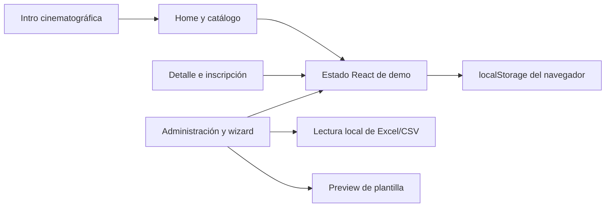
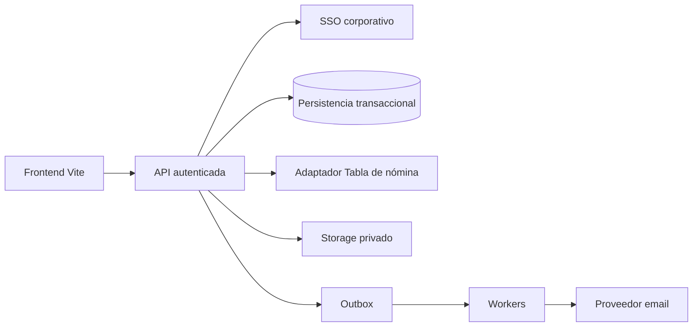

# Arquitectura del prototipo

Supernova Eventos es una micro-app de frontend construida con Vite, React y TypeScript. Demuestra el recorrido de un colaborador y la creación administrativa de eventos. **No hay backend, SSO ni envío real de emails.**

Tres presentaciones independientes están disponibles localmente: `/original/`, `/3d/` y `/hibrida/`, con selector en `/versiones/`. La raíz conserva la 3D. La original vive en `src/versions/original/`, recuperada de `c7d93f6` por lectura de Git; la híbrida agrega arte SVG sobre planos Three y cámara propia en `src/features/hybrid/`. El App espacial comparte los mismos flujos/controlador y elige su host por `variant`. Cada acceso carga su entrada lazy y recarga el documento al cambiar, manteniendo las claves locales existentes. Ver [separación e implementación híbrida](experiencia-hibrida/implementacion.md).

## Límites actuales

Los eventos e inscripciones del prototipo se resuelven en el navegador con datos sintéticos. El helper `src/lib/storage.ts` lee/escribe `localStorage` de forma defensiva; el estado es local al origen y navegador. No hay sincronización entre personas, control de cupo concurrente ni fuente corporativa de identidad. La vista administrativa sirve para explorar la demo y no representa una autorización real.

`src/types.ts` define las estructuras del mock: `EventItem`, `Registration`, `AudiencePerson` y `EmailTemplate`. La selección de nómina es ficticia. Un archivo leído en el navegador sirve para visualizar una audiencia, no para dar acceso corporativo. La plantilla de email es una vista previa, no una entrega a sus destinatarios.

## Composición

En 3D e Híbrida, `EventExplorer` usa el layout orbital: buscador, dos próximas funciones disponibles y la próxima reserva del usuario, con imágenes y textos legibles. El catálogo continúa debajo. Los marcadores DOM encuadran un planeta acotado; los encabezados secundarios son más bajos y alternan su lado. Original utiliza `layout="classic"`. [Legibilidad y registro de pases](cambios-eventos/legibilidad-y-registro-de-pases.md) describe el recorrido actual; [funciones, navegación y QR](cambios-eventos/README.md) reúne los cambios de flujos.

`EventSession` conserva el horario, puertas y cupo de cada función. Las reservas guardan `sessionId` y `sessionSnapshot`; los helpers resuelven los eventos anteriores sin funciones y mantienen los pases en su fecha original. Ambos Apps conservan guardas síncronas por evento y función para reservar/cancelar una sola vez. La disponibilidad entre dispositivos sigue dependiendo del backend. Los QR se generan localmente bajo demanda; el del usuario contiene identificadores de demostración y el del admin un enlace a evento/función en la versión actual. Ver [contratos y límites del QR](qr-y-funciones.md).

Home, Mis eventos, Favoritos y administración comparten un header centrado que cambia de barra a cápsula flotante al bajar. El creador reemplaza ese shell por una barra de pasos con volver a la izquierda. Inscripción y pase usan un `dialog` nativo fullscreen y ocultan header y footer; se cierran con X o Escape y restauran el foco. El pase incluye un calendario mensual custom de presentación, con la fecha del evento resaltada, sin alterar la reserva.

La intro se monta en cada refresh y puede repetirse desde el footer. Su timeline apunta a 3,6 segundos, con salida antes de 4 segundos, sin botón «Saltar intro», conservando Escape y movimiento reducido. GSAP se carga en su chunk lazy. El ambiente 3D se pausa cuando su región queda fuera de pantalla, se oculta la pestaña o la persona activa la pausa en Mi perfil. La intro vuelve inerte el contenido DOM sin desmontar el renderer.

`index.html` presenta el primer frame orbital con CSS crítico antes de descargar React. `IntroLoading` comparte el artwork con `CinematicIntro` y sustituye el antiguo fallback de solo logo; un reloj común conserva el avance al entregar la escena a GSAP. App retira el bootstrap y sus estilos después del primer commit. El snippet de `src/features/intro/bootstrap.html` documenta la composición inicial que debe mantenerse en sincronía con `index.html`.

`useTheme` controla la preferencia `dark | light`, persistida en `supernova-theme-v1`. Un script inicial aplica esa preferencia a `html[data-theme]` antes del primer paint; sin una elección válida el valor es oscuro, sin depender del sistema operativo. El hook actualiza también `color-scheme` y `theme-color`. `theme.css` concentra los tokens y vistas compartidas; los temas de controles, registro y administración adaptan sus componentes específicos. `scrollbars.css` personaliza el documento y los contenedores internos con colores del mismo tema. La invitación de email conserva sus colores de diseño.

Favoritos guarda identificadores locales, permite buscar y quitar eventos, y aplica los mismos filtros de visibilidad que el catálogo. Perfil y notificaciones usan popovers nativos compactos. `src/layout.css` concentra la composición compacta, el header y los ajustes responsive sobre los estilos base.

El catálogo muestra **tres eventos en total por página**, con la jerarquía **Eventos activos → Eventos próximos → Eventos finalizados**. Activo significa que empezó y todavía no terminó; próximo, que aún no empezó; finalizado, que su fecha de fin ya llegó o su estado persistido es `ended`. Los borradores y los privados sin acceso se excluyen. Los grupos sin tarjetas en la página actual no ocupan espacio; su contador muestra el total del grupo dentro de los resultados filtrados.

Búsqueda, categorías, modalidad, favoritos y fecha se aplican antes de ordenar y paginar. El orden elegido rige dentro de cada grupo y conserva la prioridad de las fases. Cambiar filtros u orden vuelve a la primera página; al reducirse los resultados se ajusta la página a la última disponible. El paginado anuncia el intervalo mostrado, admite teclado y lleva el foco al comienzo de los resultados, por debajo del header. Los finalizados permiten consultar detalles, con la inscripción cerrada y sin mensajes de cupos restantes.

`getEventPhase` clasifica los eventos sin modificar su estado guardado y `useEventClock` actualiza la home al cruzar el inicio o fin de un evento y al volver a la pestaña. Esto usa el reloj del navegador para la demo. En la integración real, el backend debe determinar las fases y la disponibilidad; el contrato deberá conservar la prioridad y el límite global de tres resultados por página.

En móvil la navegación principal y Administración se ubican en una barra inferior. La cápsula de desktop solo anima su superficie, manteniendo constante la geometría del logo. Mi perfil agrupa identidad y preferencias; Cerrar sesión modifica únicamente un estado persistido de la demo, que debe reemplazarse por el logout corporativo al integrar SSO.

Los selects, calendarios, horas y colores usan controles propios con popovers nativos. La inscripción valida con tostadas de Supernova, sin mensajes de validación del navegador. Administración mantiene filtros editados y aplicados por separado; Buscar actualiza métricas y tabla, los tags abren un diálogo para quitar filtros y el paginado muestra cinco o diez filas. Nuevos eventos no tienen TyC hasta activar su toggle e ingresar condiciones.

El stack visual usa CSS y Motion para UI, GSAP para la intro y Three.js con React Three Fiber para el universo; iconos Lucide y tipografías locales. El DOM anima transform/opacity. El engine modifica transforms de cámara/objetos y uniforms de shaders, según la experiencia 3D solicitada. Todas las capas respetan `prefers-reduced-motion`. Las operaciones de negocio no dependen de que una animación finalice.

## Universo persistente

`src/features/universe/` contiene el contrato, controlador de presentación, contexto liviano y engine lazy. `UniverseHost` es hermano del shell y permanece fuera de las vistas con `key={view}`, de los diálogos y del Suspense de intro. Mantiene un único Canvas activo, con identidad estable durante navegación, diálogos, replay y pérdida de contexto; el reintento de una excepción React reconstruye el árbol que falló. El engine no importa storage ni lee permisos. App conserva vistas, eventos, inscripciones, favoritos y estado del wizard.

Cada intención real emite un `UniverseCommand` con ID monotónico y reloj `performance.now()`. El viaje nuevo parte de la pose actual y prevalece sobre el anterior; los callbacks viejos se descartan. `ready` se informa después del primer frame renderizado. Fallos de chunk, shader o contexto habilitan el fondo estático y resuelven la presentación, preservando las acciones DOM. Perfil permite un reintento explícito: contexto y shader conservan Canvas; un import rechazado usa una segunda entrada estática lazy y una excepción React requiere reconstruir su árbol. Al recuperar se emite una nueva solicitud para el destino actual, con encuadre directo. Las historias de resoluciones y cachés de cuerpos se acotan.

Los ocho planetas del sistema solar y la nave usan coordenadas estables y superficies vectoriales locales compartidas por las dos presentaciones espaciales. `UniverseSurface` reserva regiones compactas para la cámara. Un fondo persistente, fuera de React desde el primer HTML, reutiliza la nebulosa de Tour, 60 estrellas SVG y siete partículas. Los hosts y Canvas son transparentes para compartirlo durante carga y navegación. El mouse no desplaza ninguna capa ni cámara. Mi perfil persiste la pausa en `supernova-universe-motion-v1`, independiente del tema; pausa y reduced motion detienen el fondo y usan render bajo demanda para resolver destinos sin vuelo.

Bootstrap, fallback DOM y GSAP comparten el reloj de apertura. El primer frame solar y la fuente Manrope local se presentan antes de React. El handoff conserva su sesión por reloj entre Suspense y GSAP; un chunk tardío no repone el SVG ya retirado. Al liberar la app se cancela cualquier apertura pendiente. Replay conserva sección y scroll, y excluye la pausa por región fuera de pantalla desde su primer commit.

El prompt 2 agrega materiales procedurales suaves, tres capas de estrellas, lunas instanciadas, fragmentos de Favoritos, observatorio y nave con cabina. El pool de partículas vive sólo durante el viaje. Hover/foco de controles DOM modifica una luz localizada; no emite navegación. La banda de horizonte del evento se mide por layout y scroll, mientras el DOM de origen se oculta visualmente detrás del diálogo. El prompt 3 encuadra el planeta en una región del encabezado del pase antes de su pulso y mantiene quieta la cámara durante la celebración. Las nervaduras de cabina se adaptan al ancho del viewport; pasar de paso en el wizard no cambia de destino.

Las reservas y cancelaciones locales usan guardas síncronas para evitar duplicados dentro del mismo turno. El autosave del wizard conserva su debounce, con flush de la última edición antes de cerrar, en `pagehide` y al desmontar. Guardar o publicar marca el borrador temporal como terminado antes de limpiar storage. El boundary de intro libera el shell ante un import rechazado sin afectar el resto de la app. Abrir un evento o estudio excluye desde el primer commit la pausa por una región de sección fuera de pantalla.

Los registros de alcance, verificación y límites están en [implementacion-01.md](experiencia-3d/implementacion-01.md), [implementacion-02.md](experiencia-3d/implementacion-02.md) e [implementacion-03.md](experiencia-3d/implementacion-03.md).

## Agentes del repositorio

Los agentes frontend y trailer se mantienen separados dentro de `agents/frontend/` y `agents/trailer/`. Sus instrucciones apuntan a herramientas y archivos del proyecto, respetan ownership y pueden usarse desde Codex. Las referencias de frontend en `agents/frontend/skills/` ayudan a arquitectura, integración, revisión y polish. Las carpetas originales `codex/` y `trailer-arquitect-claude-code/` se conservan como referencia; no son la autoridad del contrato backend. Ver [agents/README.md](../agents/README.md).

## Integración futura propuesta

Este diagrama es una propuesta, no infraestructura existente. La API verifica identidad, rol, compañía, audiencia y plazas; el cliente presenta resultados. Un adapter debe separar DTOs públicos del detalle administrativo: nunca devolver emails o listas de invitados con las tarjetas del catálogo.

El primer slice de integración debería incluir sesión, catálogo visible, detalle, inscripción transaccional/cancelación y borradores administrativos. Imports y campañas se conectan después con validación en servidor y seguimiento de jobs. Lista de espera, campañas programadas y check-in real son ampliaciones que requieren contrato y pruebas específicas.

El prompt completo, modelos propuestos, endpoints, errores, políticas de email, criterios de pruebas y pasos de conexión frontend están en [backend-prompt.md](backend-prompt.md). Todos deben validarse con los responsables de los sistemas corporativos antes de integrarlos.
