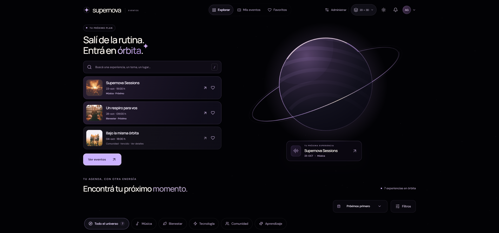

# Inicio orbital · revisión local

38 capturas en 18 contextos de Chrome 155.0.8059.40, sobre el build local servido en `http://127.0.0.1:4173/supernova-eventos/`. La revisión terminó sin errores de JavaScript, HTTP, requests fallidos, fotografías rotas ni desbordamiento horizontal. No se publicó ni desplegó.

3D e Híbrida se revisaron en oscuro y claro a **1440 × 900**, **390 × 844** y **320 × 667**, y en oscuro a **1920 × 900**. Original se revisó en ambos temas a 1440 y 320 px para comprobar su composición clásica. La fecha ficticia de los eventos se fijó al 9 de octubre de 2026; el movimiento reducido evita que las capturas dependan de una posición animada.

El buscador precede las tres filas. En escritorio estas quedan a la izquierda del planeta; en móvil las acciones del hero quedan por encima de la navegación inferior. **Ver eventos** desplaza el catálogo, le devuelve el foco y activa la cápsula del header. El mismo Canvas permanece al bajar y al paginar. Los finalizados conservan su estado real y se pueden consultar sin reservar.

| Presentación | Inicio | Catálogo / más eventos |
| --- | --- | --- |
| Híbrida · oscuro · 1920 | [Planeta y agenda](hybrid-dark-1920-hero.png) | [Catálogo](hybrid-dark-1920-catalogo.png) |
| Híbrida · oscuro · 1440 | [Inicio](hybrid-dark-1440-hero.png) | [Más eventos, página 2](hybrid-dark-1440-mas-eventos.png) |
| 3D · oscuro · 1440 | [Inicio](3d-dark-1440-hero.png) | [Más eventos, página 2](3d-dark-1440-mas-eventos.png) |
| Híbrida · oscuro · 320 | [Inicio móvil](hybrid-dark-320-hero.png) | [Catálogo móvil](hybrid-dark-320-catalogo.png) |
| Híbrida · claro · 320 | [Inicio móvil](hybrid-light-320-hero.png) | [Catálogo móvil](hybrid-light-320-catalogo.png) |
| 3D · claro · 390 | [Inicio móvil](3d-light-390-hero.png) | [Catálogo móvil](3d-light-390-catalogo.png) |
| Original · claro · 1440 | [Composición clásica](original-light-1440-hero.png) | [Catálogo](original-light-1440-catalogo.png) |

[Registro de geometría, fases, Canvas y errores](orbital-review.json). Script: [orbital-home-review.mjs](../../../scripts/orbital-home-review.mjs). Las otras galerías se conservan como registros anteriores.
