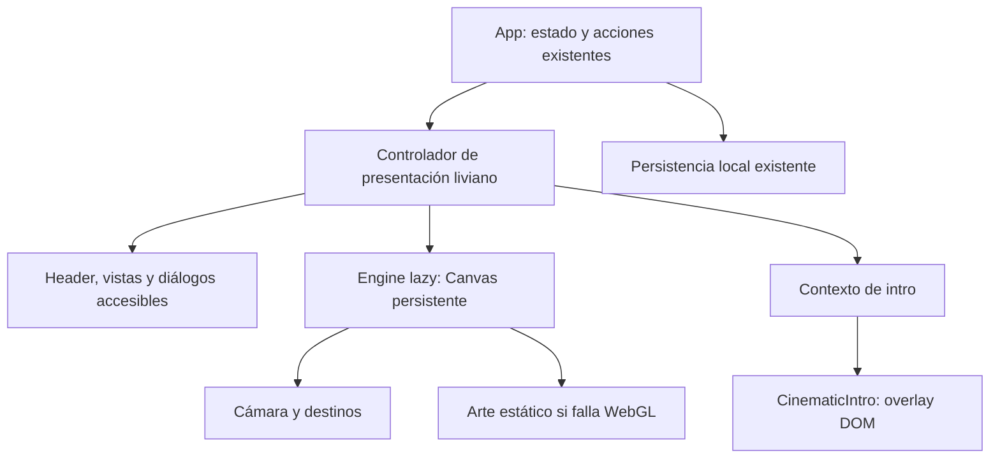

# Supernova · un universo para recorrer

Propuesta y pack de **3 prompts de implementación**, preparados para **GPT 6.1 Sol con razonamiento ULTRA**. Fecha: 8 de octubre de 2026. Seleccioná ese modelo y nivel de razonamiento en la sesión que los ejecute; estos archivos no cambian la configuración del agente.

**Estado al 9 de octubre de 2026: los tres prompts implementados y verificados localmente.** El universo persistente incluye apertura solar, planetas con identidad propia, lunas, partículas, viajes de cámara, detalle de eventos, pulso de confirmación, pase integrado y nave con cabina adaptable. Los registros de alcance, pruebas y límites están en [implementacion-01.md](implementacion-01.md), [implementacion-02.md](implementacion-02.md) e [implementacion-03.md](implementacion-03.md). La [galería final](captures/prompt-3/README.md) reúne ambos temas y tamaños; los registros anteriores se conservaron. Build, 58 pruebas integradas y las regresiones tras el pulido aprobaron. **No hubo deploy, publicación, commit ni push.** El workflow existente publica con cada push a `main`; este trabajo se revisa localmente.

## Cómo usar los tres prompts

Ejecutalos en orden, dentro de este repositorio. Cada archivo es un único prompt completo; adjuntá este README como brief y contrato compartido. Si seguís en otra sesión, el agente debe leer el estado del código y los resultados anteriores antes de continuar.

| Orden | Prompt | Resultado local que debe quedar funcionando |
| --- | --- | --- |
| 1 | [Fundación y primer recorrido](01-fundacion-y-primer-recorrido.md) | Hero con planeta realmente 3D, fondo espacial persistente y viajes entre las secciones actuales, con fallback y flujos preservados. |
| 2 | [Universo y viajes cinematográficos](../trailer/experiencia-3d/02-universo-y-viajes.md) | Sistema solar de apertura, planetas con materiales propios, partículas, cámara pulida, nave y continuidad visual. |
| 3 | [Flujos, interacción y calidad](03-flujos-y-calidad.md) | Entrada a eventos, inscripción, pase y creación a bordo integrados; teclado, móvil, rendimiento y regresiones verificados. |

No se necesitan un cuarto prompt, un backend ni generación de video para cumplir este alcance. Cada etapa debe dejar una app ejecutable; los acabados de la siguiente no justifican romper un flujo existente.

## La experiencia elegida

Un sistema solar propio de Supernova, con profundidad real y mucho espacio negro. La cámara viaja entre destinos que existen en un mismo mundo. Los planetas tienen volumen, superficie, terminador de luz y anillos que pasan por delante y por detrás; las estrellas dan escala. La tipografía, los datos y los controles permanecen en HTML legible.

La identidad conserva el logo, las fuentes y las portadas existentes. El valor visual viene de siluetas reconocibles, luz medida, materiales cuidados y transiciones con intención. El destino se identifica por su forma además de su color.

| Destino | Identidad espacial | Qué hace la persona |
| --- | --- | --- |
| Inicio / Explorar | Planeta violeta oscuro con anillo inclinado, luz hueso y borde lavanda. | Descubre el destacado y baja al catálogo con scroll normal. |
| Mis eventos | Planeta mineral teal con tres lunas en órbitas de distintas profundidades. | Consulta sus inscripciones y abre el pase. Las tres lunas son composición, no un contador de reservas. |
| Favoritos | Planeta ámbar, anillo fino y satélites asociados a eventos guardados, con límite visual. | Guarda o quita eventos y los encuentra también en la lista accesible. No se renderiza un objeto por cada favorito sin límite. |
| Mi perfil | Mundo perlado pequeño y sereno. | Cambia sus preferencias y recorre la sesión demo. |
| Administración | Nave reconocible desde el exterior, cerca de una baliza orbital. | Usa las métricas, la tabla y los filtros actuales. |
| Crear / editar / retomar | Acercamiento a la nave y entrada a su cabina. | Completa el wizard a bordo. El ingreso sucede una vez; los pasos no disparan nuevos viajes. |
| Evento | Órbita cercana de un cuerpo con identidad estable según `event.id` y su categoría. | Ve detalle, condiciones, cupos y formulario en el diálogo actual. Al cerrar vuelve al destino de origen. |
| Inscripción confirmada | Un pulso breve de luz y partículas alrededor del destino del evento. | Recibe su pase después de una inscripción válida. La confirmación local no espera a la animación. |

El detalle de composición, coordenadas y tiempos vive en el prompt 2. Inicio apunta a 3,6 segundos, con límite de 4; navegación a 0,8–1,1 segundos; evento a 0,65–0,8 segundos; confirmación a 0,45–0,6 segundos. Son duraciones de diseño, no esperas obligatorias para operar.

## Decisiones visuales y de interacción

- Fondo negro `#020205` en toda la experiencia, también con la preferencia de paneles claros. La preferencia `supernova-theme-v1` se respeta para controles y superficies; no se borra ni se fuerza a oscuro. Bootstrap, `html`, `body`, shell y espacios entre secciones deben ser coherentes desde el primer frame.
- Texto principal hueso; lavanda como acento de marca. Brillos localizados, negros profundos, niebla muy tenue y partículas discretas. No cubrir la pantalla con nebulosas saturadas o bloom.
- Header normal arriba, cápsula flotante al hacer scroll y navegación móvil inferior. Sin sidebar, sin secuestrar el scroll y sin rueda del mouse convertida en zoom de cámara.
- Puntero: parallax acotado y respuesta de luz en la región del hero. Acciones espaciales opcionales tienen botones DOM equivalentes. Touch y teclado resuelven el mismo recorrido sin hover ni gestos obligatorios.
- Una sola cámara en viaje y un grupo protagonista por toma. El texto y el formulario no giran con el universo. No hay audio automático ni giro continuo de cámara mientras se lee.
- Movimiento reducido: composición estática cuidada, cambios directos o fundido de hasta 200 ms, sin zoom, vuelo, parallax ni rotación orbital ambiental. Cambiar la preferencia en ejecución detiene el movimiento activo.
- Preferencia DOM en Mi perfil: «Pausar movimiento» / «Reanudar movimiento», con estado accesible y persistencia local independiente del tema. La pausa detiene el ambiente y convierte los viajes en cambios directos o fundidos de hasta 200 ms; los controles y callbacks siguen resolviendo el destino más reciente.

## Estado real del repositorio

La propuesta se apoya en estos puntos del repositorio. La implementación del prompt 1 conserva sus fuentes de verdad de negocio:

| Área actual | Punto de integración |
| --- | --- |
| `src/App.tsx` | Mantiene `view`, `selectedEvent`, `studioActive`, eventos, favoritos e inscripciones. Las vistas están dentro de un `motion.div` con `key={view}`. |
| `src/components/CosmicScene.tsx` | Planeta actual SVG + Motion. Su CTA al destacado debe conservarse; su arte sirve como fallback y referencia de marca. |
| `src/types.ts` | `AppView = explore \| registrations \| favorites \| admin \| profile`; eventos e inscripciones tipados. No ampliar `AppView` para estados puramente visuales. |
| `src/features/intro/**` y `index.html` | Bootstrap HTML, fallback y escena lazy comparten reloj. `CinematicIntro({ onComplete })` apunta a 3,6 s, libera antes de 4 s y aparece en cada refresh. |
| `src/features/registration/RegistrationModal.tsx` | Diálogo nativo fullscreen con formulario y pase. Un diálogo opaco tapa un Canvas global, aunque suba su `z-index`. |
| `src/features/admin/AdminPanel.tsx` | `onWizardChange(boolean)` comunica aperturas y cierres reales del estudio. El cleanup dejó de emitir viajes falsos en StrictMode; App resuelve la navegación. |
| `src/features/admin/EventWizard.tsx` | Borrador local con autosave; la escena no debe desmontar ni reiniciar el paso. |
| `src/lib/assets.ts` y `vite.config.ts` | El helper actual resuelve `/images/`; modelos y texturas nuevos necesitan resolución de `BASE_URL`. Producción y preview usan `/supernova-eventos/`. |
| `playwright.config.ts` y `tests/` | Suite existente; modo de movimiento reducido por defecto, con casos que controlan el reloj. El QA 3D debe habilitar movimiento explícitamente cuando lo revise. |

La base usa React 19.2, TypeScript, Vite, Motion y GSAP. El prompt 1 instaló `three@0.186.1`, `@react-three/fiber@9.8.1` y `@types/three@0.186.0`; no incorpora GLB ni texturas externas. Las inscripciones, la sesión, eventos, borradores y preferencias son locales. SSO, cupos concurrentes, nómina y envío de emails siguen dependiendo del backend descripto en [backend-prompt.md](../backend-prompt.md).

## Arquitectura acordada entre roles

**Un Canvas persistente, un renderer, un controlador de cámara.** Su montaje queda fuera del árbol con `key={view}` y fuera del `Suspense` de la intro. El host liviano y el estado de presentación no importan Three.js ni GSAP: el engine 3D se carga lazy; GSAP permanece en el chunk de intro.



Archivos creados en el prompt 1:

- `src/features/universe/contracts.ts`: contrato compartido, sólo tipos.
- `src/features/universe/UniverseHost.tsx`, `useUniverseController.ts` y `presentation.tsx`: integración y contexto sin dependencias 3D.
- `src/features/universe/UniverseSurface.tsx`: reserva DOM para componer planetas y nave sin superponer títulos o acciones.
- `src/features/universe/UniverseExperience.tsx`: entrada lazy al renderer.
- `src/features/universe/scene.config.ts`, `CameraRig.tsx`, `Planet.tsx`, `Starfield.tsx`, `Spaceship.tsx` y `universe.css`: escena y configuración separadas del negocio. Shaders en un subdirectorio propio si son necesarios.
- `tests/universe.spec.ts` y scripts de revisión visual: sólo las comprobaciones necesarias para los comportamientos nuevos.

Los nombres internos pueden ajustarse con motivo documentado, manteniendo el contrato público:

```ts
import type { AppView, EventCategory } from '../../types';

export type UniverseDestination =
  | { kind: 'section'; view: AppView }
  | { kind: 'event'; eventId: string; category: EventCategory }
  | { kind: 'studio' };

export type UniverseStatus = 'loading' | 'ready' | 'fallback' | 'context-lost';
export type UniverseQuality = 'auto' | 'low' | 'balanced' | 'high';

export interface UniverseCommand {
  requestId: number;
  issuedAtMs: number; // Reloj monotónico performance.now(), no Date.now().
  destination: UniverseDestination;
  reason:
    | 'boot' | 'navigate' | 'open-event' | 'close-event'
    | 'open-studio' | 'close-studio' | 'registration-success' | 'replay';
}

export interface UniverseSettled {
  requestId: number;
  outcome: 'arrived' | 'cancelled' | 'fallback';
}

export interface UniverseExperienceProps {
  command: UniverseCommand;
  favoriteSatellites: readonly { eventId: string; category: EventCategory }[];
  reducedMotion: boolean;
  paused: boolean;
  quality: UniverseQuality;
  onSettled: (result: UniverseSettled) => void;
  onStatusChange: (status: UniverseStatus) => void;
}

export interface UniversePresentation {
  status: UniverseStatus;
  command: UniverseCommand;
  introStartedAtMs: number;
}
// useUniversePresentation(): UniversePresentation; contexto liviano del host.
// CinematicIntro conserva default export y props { onComplete: () => void }.
```

### Semántica del contrato

1. El host incrementa `requestId` por intención real de usuario. La última intención gana: cancelar un viaje retoma desde la pose actual, sin regresar al inicio ni acumular callbacks. Se informa como máximo un resultado por request; el host descarta callbacks de requests anteriores. Un request ya completado antes de cargar un chunk no vuelve a animarse.
2. `issuedAtMs` permite continuar una escena que comenzó durante bootstrap o fallback. En `boot`, el origen es el reloj del bootstrap; en `replay`, un reloj nuevo estable durante esa reproducción. El reloj y los IDs no se reinician por effects de StrictMode.
3. `boot` llega a `explore`. `replay` muestra el sistema solar y vuelve a la sección que estaba activa, conservando su estado y scroll. El replay no implica navegar al inicio.
4. `ready` significa recursos críticos listos **y primer frame 3D renderizado**. Importar el módulo o crear el renderer no alcanza. Recursos opcionales, como texturas de mayor resolución, no bloquean la apertura.
5. `onSettled` informa presentación: jamás registra, cancela, publica un evento ni abre un formulario por sí mismo. Ante error, timeout, Escape o WebGL ausente se resuelve la presentación y la UI permanece operativa.
6. La intro termina como máximo a los 4 s desde su reloj mientras React está disponible; movimiento reducido libera en hasta 200 ms. El HTML inicial también debe dejar de bloquear visualmente al vencer ese límite. Si JavaScript todavía no llegó, no se puede prometer que la app sea operativa: conservar un fallback de carga honesto. No hay porcentajes inventados ni botón «Saltar intro»; Escape continúa.
7. El host conserva una pila pequeña de destinos de retorno: un evento abierto desde el estudio regresa a la cabina y su paso; desde Favoritos regresa a Favoritos. El cierre del diálogo y el foco son inmediatos, aunque el viaje de retorno continúe.
8. `registration-success` es un efecto sobre el destino actual del evento. Se emite una sola vez por nueva inscripción válida y nunca por devolver un pase ya existente, error o falta de cupo. No obliga a navegar a Mis eventos.
9. Un modal deshabilita la interacción espacial de fondo, pero no necesariamente el render decorativo. `paused` combina pausa voluntaria, pestaña oculta y composición no visible; congela el ambiente y resuelve órdenes nuevas mediante pose final sin vuelo, sin cola bloqueada. Renderizar sólo el frame necesario cuando sea visible. Reduced motion usa además render estático/bajo demanda. El fin de intro no deja accidentalmente pausada la escena.
10. `favoriteSatellites` llega del host: como máximo ocho eventos guardados visibles, sin borradores, filtrados con las reglas existentes y ordenados de manera estable por ID. Incluye solamente ID y categoría. El engine no lee storage, no infiere permisos y no mantiene un segundo catálogo; el total y la lista completa pertenecen al DOM de Favoritos. Empty state entrega una lista vacía.

### Diálogos y nave sin duplicar escena

El Canvas permanece en su lugar durante todo el recorrido. El diálogo nativo de evento usa un scrim translúcido y una región decorativa que deja ver el planeta detrás; el formulario, las condiciones y el pase tienen superficies legibles. No mover el Canvas a un portal, no crear otro Canvas para el diálogo ni romper `showModal()` para verlo.

La navegación mantiene una fuente de verdad frontend. El estado del wizard, su borrador y su paso no se reemplazan por estado de la cámara. El contrato de `onWizardChange` puede ampliarse dentro del rol frontend, pero su cleanup no equivale a un clic en «Volver». Entrar al estudio coloca la cámara en la cabina; completar pasos no vuelve a embarcar.

### Propiedad exclusiva de archivos

| Rol | Mantiene | Coordinación |
| --- | --- | --- |
| Frontend | `src/features/universe/**`, `src/App.tsx`, componentes/vistas/tema, `index.html`, dependencias y tests. | Es el único que integra el host, la cámara y el bootstrap HTML. Implementa la escena según el storyboard acordado. |
| Trailer | `src/features/intro/**` y `docs/trailer/**`. | Mantiene la intro y su plantilla `bootstrap.html`; entrega el bloque final al frontend para sincronizar `index.html`. No edita el host ni el engine. |

Si se usan subagentes, heredan el modelo de la sesión. Acordar estos tipos antes de editar; una sola persona integra cada archivo. Conservar packs originales y cambios ajenos.

## Assets, rendimiento y robustez

Primera versión autosuficiente: planetas con geometría y materiales procedurales; nave modelada con piezas coherentes, casco, cabina y luces sobrias; estrellas con `Points`/instancing. No condicionar el resultado a comprar un modelo o a descargar assets de terceros. Un GLB futuro sólo se incorpora si existe, tiene licencia documentada y mejora la nave; no prometer archivos que todavía no están.

`three`, `@react-three/fiber` y tipos compatibles son la base. Drei es opcional, con imports puntuales y versiones compatibles. No sumar Zustand, un router nuevo ni un segundo motor de animación para algo que el estado React y `useFrame` ya resuelven. React 19 se corresponde con R3F 9 según la [guía oficial de instalación](https://r3f.docs.pmnd.rs/getting-started/installation); comprobar los peer dependencies actuales al instalar y conservar el lockfile.

Estos son **presupuestos propuestos**, no resultados medidos:

| Perfil | DPR máximo | Estrellas | Triángulos visibles | Draw calls por frame | Efectos |
| --- | --- | --- | --- | --- | --- |
| `high` | 1,5 | 1.800 | 100.000 | 60 | Atmósfera y brillo localizado; postproceso sólo si la medición lo permite. |
| `balanced` | 1,25 | 600 | 40.000 | 35 | Atmósfera simple; sin composer. |
| `low` | 1 | 180 | 18.000 | 20 | Luz y silueta; partículas estáticas en reposo. |

`auto` arranca conservador y ajusta según medición con histéresis, sin oscilar continuamente. Objetivos: 60 FPS en el equipo desktop de revisión y 30 FPS en móvil de referencia; registrar hardware, navegador y escena. Adicional lazy 3D objetivo ≤450 KiB gzip y recursos críticos nuevos ≤1,5 MB transferidos. Si se exceden, medir, optimizar y documentar el valor real; no afirmar resultados por inspeccionar el código.

Compartir geometrías/materiales, limitar recursos por evento y disponer sólo lo que pertenezca al componente desmontado. No generar infinitos planetas ni guardar una caché GLB por cada evento. El render bajo demanda y el DPR adaptativo siguen las posibilidades de [React Three Fiber](https://r3f.docs.pmnd.rs/advanced/scaling-performance); declarar quién invalida durante un viaje y cuándo se detiene. Evitar `setState` y crear vectores/materiales en cada frame, siguiendo las [recomendaciones del renderer](https://r3f.docs.pmnd.rs/advanced/pitfalls).

Errores del chunk, shader, recurso o contexto WebGL activan el arte estático y liberan la presentación. Recuperar el contexto una vez si es viable, con el destino más reciente; una falla repetida conserva fallback sin bucle de recarga. Perfil permite reintento explícito de un fallo. Contexto/shader conservan el Canvas; un árbol React inválido se reconstruye sólo con ese reintento. Una entrada lazy alternativa permite un segundo fetch después de un rechazo del import, también bajo el prefijo de producción. Todos los assets y decoders locales respetan `import.meta.env.BASE_URL`.

## Criterio de experiencia completa

Se considera lista cuando se recorre localmente apertura → hero → Mis eventos → Favoritos → evento → inscripción → pase → Administración → creación en nave, con retornos correctos, datos persistidos y cero bloqueos de navegación. Además:

- Los viajes son movimiento de cámara/objetos 3D y dejan ver profundidad y oclusión; no son un cambio de SVG con fundido.
- Pantallas y formularios funcionan también en fallback y con movimiento reducido. Foco visible, labels, Escape y restitución de foco permanecen correctos.
- Revisar 320, 390, 768, 1440 y 1920 px, ambos temas de superficies, scroll, teclado virtual y safe areas. La nave no reduce el formulario a una consola ilegible.
- Capturas y video local con movimiento habilitado, semilla fija y congelación explícita de la escena para comparar frames. Desactivar animaciones CSS en Playwright no congela WebGL.
- Build y pruebas de flujos existentes más pruebas específicas de interrupción, carga, foco y fallback. [Playwright Clock](https://playwright.dev/docs/clock) diferencia fijar la fecha de controlar todos los temporizadores: el plan de pruebas debe contemplar ambos.
- Informar comandos ejecutados, resultados y límites. Las metas visuales y de rendimiento no se reportan como cumplidas sin revisión.

## Verificación del pack original, anterior a la implementación

La primera entrega documentó el brief, los contratos y tres prompts, sin modificar `src/`, dependencias, escenas ni flujos. Su `npm run build` pasó el 8 de octubre de 2026; no se ejecutaron E2E en esa entrega documental. Se revisaron cuatro documentos, exactamente tres prompts, seis enlaces locales, bloques de código y consistencia de contratos. Las verificaciones de la experiencia implementada se registran por separado en [implementacion-01.md](implementacion-01.md).
