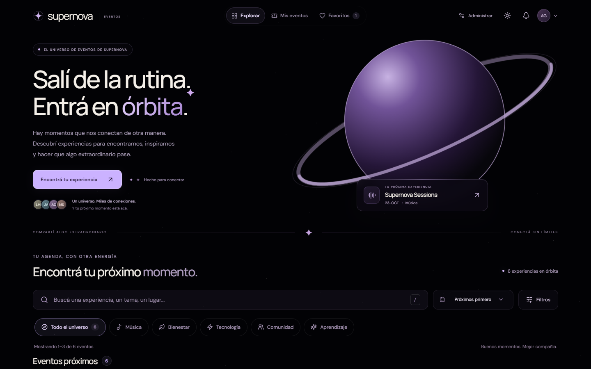
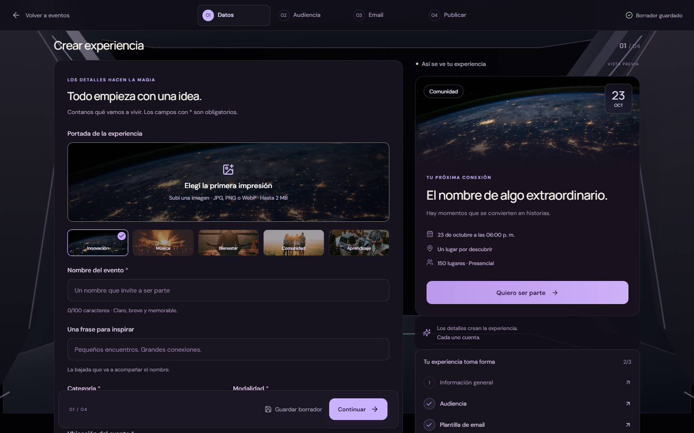

# Galería · Órbitas 2D + 3D

48 capturas de recorridos con reloj vivo; 18 poses de carga con reloj controlado. Chrome de Windows, viewports emulados. Sin deploy.

[Datos de recorridos](review.json) · [Datos de la intro](intro/review.json) · [Implementación](../implementacion.md)

[Preview de las tres versiones](preview/review.json): 18 comprobaciones y 24 capturas bajo `/supernova-eventos/`. Comparación de escritorio: [original](preview/original-dark-1440.png), [3D](preview/3d-dark-1440.png), [híbrida](preview/hibrida-dark-1440.png). La original también completó su inscripción/pase en ambos temas y los tres anchos.

## 1440x900

| Recorrido | Oscuro | Claro |
| --- | --- | --- |
| hero | [Ver](01-hero-dark-1440x900.png) | [Ver](01-hero-light-1440x900.png) |
| mis-eventos | [Ver](02-mis-eventos-dark-1440x900.png) | [Ver](02-mis-eventos-light-1440x900.png) |
| favoritos | [Ver](03-favoritos-dark-1440x900.png) | [Ver](03-favoritos-light-1440x900.png) |
| evento | [Ver](04-evento-dark-1440x900.png) | [Ver](04-evento-light-1440x900.png) |
| pase | [Ver](05-pase-dark-1440x900.png) | [Ver](05-pase-light-1440x900.png) |
| nave | [Ver](06-nave-dark-1440x900.png) | [Ver](06-nave-light-1440x900.png) |
| cabina | [Ver](07-cabina-dark-1440x900.png) | [Ver](07-cabina-light-1440x900.png) |
| cabina-editando | [Ver](08-cabina-editando-dark-1440x900.png) | [Ver](08-cabina-editando-light-1440x900.png) |

## 390x844

| Recorrido | Oscuro | Claro |
| --- | --- | --- |
| hero | [Ver](01-hero-dark-390x844.png) | [Ver](01-hero-light-390x844.png) |
| mis-eventos | [Ver](02-mis-eventos-dark-390x844.png) | [Ver](02-mis-eventos-light-390x844.png) |
| favoritos | [Ver](03-favoritos-dark-390x844.png) | [Ver](03-favoritos-light-390x844.png) |
| evento | [Ver](04-evento-dark-390x844.png) | [Ver](04-evento-light-390x844.png) |
| pase | [Ver](05-pase-dark-390x844.png) | [Ver](05-pase-light-390x844.png) |
| nave | [Ver](06-nave-dark-390x844.png) | [Ver](06-nave-light-390x844.png) |
| cabina | [Ver](07-cabina-dark-390x844.png) | [Ver](07-cabina-light-390x844.png) |
| cabina-editando | [Ver](08-cabina-editando-dark-390x844.png) | [Ver](08-cabina-editando-light-390x844.png) |

## 320x667

| Recorrido | Oscuro | Claro |
| --- | --- | --- |
| hero | [Ver](01-hero-dark-320x667.png) | [Ver](01-hero-light-320x667.png) |
| mis-eventos | [Ver](02-mis-eventos-dark-320x667.png) | [Ver](02-mis-eventos-light-320x667.png) |
| favoritos | [Ver](03-favoritos-dark-320x667.png) | [Ver](03-favoritos-light-320x667.png) |
| evento | [Ver](04-evento-dark-320x667.png) | [Ver](04-evento-light-320x667.png) |
| pase | [Ver](05-pase-dark-320x667.png) | [Ver](05-pase-light-320x667.png) |
| nave | [Ver](06-nave-dark-320x667.png) | [Ver](06-nave-light-320x667.png) |
| cabina | [Ver](07-cabina-dark-320x667.png) | [Ver](07-cabina-light-320x667.png) |
| cabina-editando | [Ver](08-cabina-editando-dark-320x667.png) | [Ver](08-cabina-editando-light-320x667.png) |

## Carga → hero

1440px: [100 ms](intro/carga-1440-0100ms.png) · [1000 ms](intro/carga-1440-1000ms.png) · [1400 ms](intro/carga-1440-1400ms.png) · [1800 ms](intro/carga-1440-1800ms.png) · [2150 ms](intro/carga-1440-2150ms.png) · [2500 ms](intro/carga-1440-2500ms.png) · [2850 ms](intro/carga-1440-2850ms.png) · [3250 ms](intro/carga-1440-3250ms.png) · [3650 ms](intro/carga-1440-3650ms.png)

390px: [100 ms](intro/carga-390-0100ms.png) · [1000 ms](intro/carga-390-1000ms.png) · [1400 ms](intro/carga-390-1400ms.png) · [1800 ms](intro/carga-390-1800ms.png) · [2150 ms](intro/carga-390-2150ms.png) · [2500 ms](intro/carga-390-2500ms.png) · [2850 ms](intro/carga-390-2850ms.png) · [3250 ms](intro/carga-390-3250ms.png) · [3650 ms](intro/carga-390-3650ms.png)

6 recorridos conservaron el Canvas y emitieron un pase cada uno. Cero errores JS/consola/requests fallidas y cero desbordes horizontales. Máximo estático: 7 calls / 8 triángulos. La intro verifica coincidencia de centro/diámetro a 1,4 s con tolerancia de 2 px.

Las poses de intro se obtienen avanzando el reloj Playwright sobre una apertura con assets ya calientes. Las capturas de recorridos desactivan animaciones DOM durante el screenshot; la escena Three mantiene su reloj. No son pruebas de GPU ni de dispositivos móviles físicos.
